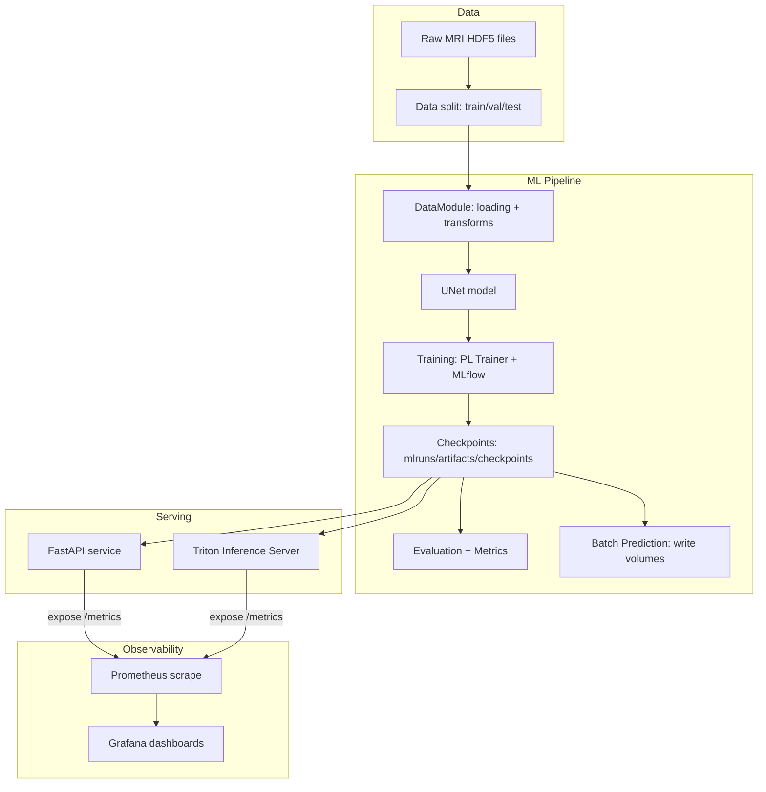
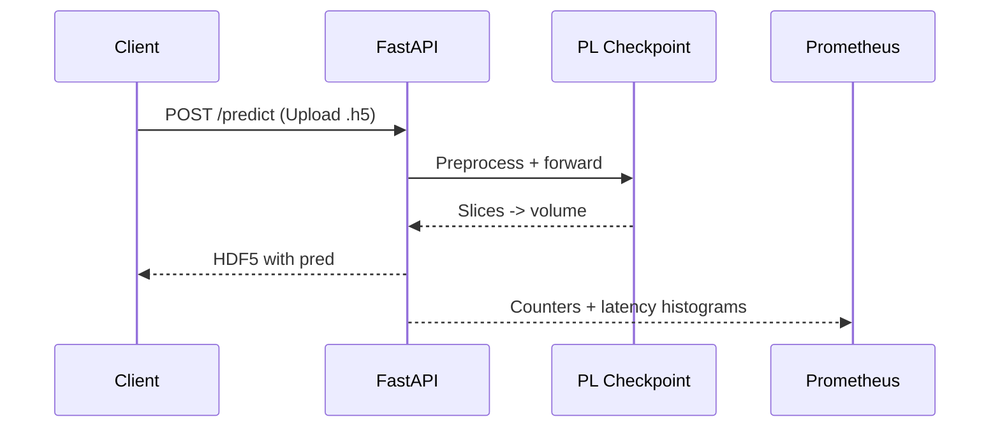

# fastmri-knee: End-to-End MRI Reconstruction and Serving

## 1. Project Title & Description
An end-to-end pipeline for knee MRI reconstruction using PyTorch Lightning. The repo covers training, evaluation, batch inference, and two serving options (FastAPI and NVIDIA Triton), with production-ready monitoring via Prometheus and Grafana. Config is managed with Hydra; experiments and artifacts are tracked with MLflow.

## 2. Overview / Motivation
- Provide a reproducible baseline for knee MRI reconstruction on FastMRI-style HDF5 data.
- Offer batteries-included infrastructure: config management, experiment tracking, serving, and monitoring.
- Demonstrate both Python-native serving (FastAPI) and high-performance model serving (Triton) patterns.

## 3. Architecture / Pipeline Overview


Request flow (FastAPI):


## 4. Features
- Training with PyTorch Lightning and Hydra configs.
- MLflow experiment tracking and checkpoint artifact logging.
- Batch evaluation and prediction utilities.
- Two serving options: FastAPI and Triton.
- Prometheus metrics and Grafana dashboards for latency/health.

## 5. Dataset / Data Sources
This project targets the FastMRI knee single-coil dataset. Acquire data from the FastMRI site.

- Place files as:
  - `data/train/*.h5`
  - `data/val/*.h5`
  - `data/test/*.h5` (optional)

You can adapt to other datasets by modifying `configs/datamodule.yaml` and the `src/fastmri_knee/data/__init__.py` dataset/transform logic.

## 6. Data Preprocessing
`src/fastmri_knee/data/__init__.py` defines `FastMRICustomDataset` and `FastMRITransform` that read HDF5, apply optional masks, and return tensors for the UNet. Random undersampling masks are controlled in code and configs.

## 7. Feature Engineering
MRI-specific preprocessing focuses on k-space undersampling and image normalization rather than classic tabular feature engineering. Extend `FastMRITransform` for domain-specific augmentations if needed.

## 8. Model Architecture / Approach
- UNet-based architecture defined in `src/fastmri_knee/model.py` with configurable channels/pools (`configs/model.yaml`).
- Loss/metrics (e.g., PSNR) tracked via PyTorch Lightning.

## 9. Training
Dependencies (uv):

```bash
uv sync
```

Run training with Hydra config:

```bash
python -m fastmri_knee.train
```

Key training config knobs (`configs/trainer.yaml`):
- accelerator/devices: GPU or CPU, number of devices
- max_epochs, batch_size
- optimizer and scheduler params
- checkpointing: monitor metric, mode, save_top_k
- MLflow tracking URI and experiment name

Data config (`configs/datamodule.yaml`):
- `data_root`, `train_root`, `val_root`, `test_root`
- `batch_size`, `num_workers`

Model config (`configs/model.yaml`):
- `num_chans`, `num_pools`, `dropout`

Artifacts and metrics are logged under `mlruns/` (local file store by default).

## 10. Hyperparameter Tuning
Skeleton support in `configs/trainer.yaml` under `trainer.tune` with `n_trials` and `timeout`. Integrate your preferred tuner (Optuna, Ray Tune) by extending `src/fastmri_knee/tune.py`.


## 11. Evaluation
Evaluate a trained checkpoint on a validation folder:

```bash
# uses cfg.trainer.eval.data_path (defaults to ./data/val)
python -m fastmri_knee.evaluate
```

Notes:
- If `cfg.trainer.run_id` is unset, the script auto-selects the best MLflow run via the configured metric.
- Results are printed and optionally saved to `trainer.EVAL_RESULTS_FILE` if provided.

## 12. Results / Visualizations
- Metrics CSV and hyperparams are stored under `lightning_logs/` and `mlruns/`.
- A sample Grafana panel `docs/img/grafana_latency.png` shows serving latency distribution when FastAPI is instrumented.

## 13. Inference / Prediction
Batch prediction to write volumes per file:

```bash
# data path from cfg.trainer.predict.data_path (default: ./data/test)
python -m fastmri_knee.predict
```

Outputs are saved under `trainer.PREDICTIONS_DIR` (defaults to `data/outputs/${run_id}/`).

## 14. Deployment
Two serving modes are supported:

- FastAPI (Python-native server, Prometheus-instrumented)
- NVIDIA Triton (high-performance model server)

See details below.

## 15. Experiment Tracking
MLflow is used via the Lightning logger. By default, the tracking URI uses a local file store:

```yaml
trainer:
  MLFLOW_TRACKING_URI: 'file:${project_root}/mlruns'
  train:
    experiment_name: fastmri
```

Checkpoints are logged to run artifacts under `mlruns/<exp_id>/<run_id>/artifacts/checkpoints/`.

## 16. Model Versioning & Reproducibility
- Runs are versioned via MLflow `experiment_name` and `run_id`.
- Checkpoints are stored per run; `fastmri_knee.predict.get_best_checkpoint` selects the best in the `checkpoints` subdir.
- Random seeds are set via `trainer.seeds`.

## 17. Configuration
Hydra root config: `configs/config.yaml` with defaults to `model`, `datamodule`, `trainer`, and `triton`.

Common overrides (environment-aware):

```bash
# examples
python -m fastmri_knee.train trainer.train.max_epochs=10 datamodule.batch_size=8

# or via env vars (see configs/trainer.yaml)
export batch_size=8
python -m fastmri_knee.train
```

Key files:
- `configs/trainer.yaml`
- `configs/datamodule.yaml`
- `configs/model.yaml`
- `configs/triton.yaml`

## 18. Project Structure
```
├─ configs/
│  ├─ config.yaml              # Hydra defaults
│  ├─ trainer.yaml             # Training/eval/predict params
│  ├─ datamodule.yaml          # Data paths + loader settings
│  └─ model.yaml               # UNet hyperparams
├─ deploy/
│  └─ services/
│     ├─ fastapi/              # FastAPI app, schemas, Docker compose
│     └─ triton/               # Triton compose, model repo config
├─ src/
│  └─ fastmri_knee/
│     ├─ data/__init__.py      # Dataset + transforms
│     ├─ model.py              # LightningModule: UNet wrapper
│     ├─ metrics.py            # NMSE
│     ├─ train.py evaluate.py predict.py tune.py   # Hydra entrypoints (python -m fastmri_knee.<name>)
│     └─ packaging/export.py   # ONNX export + parity check
├─ monitoring/
│  ├─ prometheus/              # prometheus.yml (scrape jobs, Alertmanager), rules/
│  ├─ alertmanager/            # alertmanager.yml + render.sh (adds Slack when SLACK_WEBHOOK_URL is set)
│  ├─ alert-sink/              # local webhook receiver that logs every alert
│  ├─ loki/ alloy/             # log storage and the Docker-log collector
│  └─ grafana/                 # Provisioning + dashboards
├─ mlruns/                     # MLflow local tracking
└─ data/                       # train/val/test splits
```


## 19. Testing
Run tests (where available):

```bash
pytest -q
```

## 20. Reproducibility / Environment
- Managed via `uv` with lockfile `uv.lock`.
- Determinism: seeds (see `trainer.seeds`) and controlled dataloading.
- Hardware: supports CPU/GPU; Apple Silicon (MPS) is detected in ONNX export.


## 21. FAQ / Troubleshooting
- Port conflicts: change FastAPI port 8000, Prometheus 9090, Grafana 3000.
- Run ID not found: ensure MLflow runs exist and checkpoints saved.
- GPU not used: set `trainer.accelerator=gpu` and `trainer.gpus=1`.

---

### Detailed How-To

#### Get Data
1) Register and download from FastMRI.
2) Extract files into `data/train`, `data/val`, and optionally `data/test`.
3) Verify `configs/datamodule.yaml` paths.

Or let the CLI do steps 1-2: put the signed archive link in the `url` environment variable and run `make data`
(`python -m fastmri_knee.data.prepare --root data`; `--archive FILE` uses an already-downloaded tarball). It downloads,
extracts and splits train/val by subject. Training only checks that the data exists and tells you what to run if not.

#### Train
```bash
uv sync
python -m fastmri_knee.train --config configs/config.yaml \
  trainer.train.max_epochs=1 datamodule.batch_size=16
```

#### Evaluate
```bash
python -m fastmri_knee.evaluate --config configs/config.yaml \
  trainer.eval.data_path=./data/val
```

#### Batch Predict
```bash
python -m fastmri_knee.predict --config configs/config.yaml \
  trainer.predict.data_path=./data/test
```

### Serving: gateway (FastAPI) in front of Triton
The gateway is torch-free and talks to Triton over gRPC (see SPEC-gateway.md). Endpoints:
- `GET /healthz`, `GET /readyz` (no auth)
- `POST /v1/reconstructions` (multipart `.h5` under field `file`; optional demo query `acceleration`) -> `.h5`
- `POST /v1/infer` (raw float32 N x 1 x 320 x 320), `GET /v1/model`
- `/evaluate` and `/predict` were dropped (Q9); evaluation is offline.

```bash
make api-key        # prints a key once; stores only its hash in secrets/api_keys
make up             # gateway :8000, Triton, MLflow, Prometheus, Grafana
curl -H "X-API-Key: $KEY" -F file=@sample.h5 localhost:8000/v1/reconstructions -o out.h5
```

### Serving Option 2: Triton
1) Export ONNX from a trained checkpoint:

```bash
python -m fastmri_knee.packaging.export  # adjust checkpoint path inside script
```

2) Place the exported ONNX into a Triton model repository (example in `deploy/services/triton/models/unet_model/`). Ensure the `config.pbtxt` matches input/output names and shapes.

3) Start Triton with monitoring:

```bash
docker compose -f deploy/services/triton/docker-compose.triton.yml up -d

# Triton HTTP:  http://localhost:8000
# Triton GRPC:  localhost:8001
# Triton METRICS: http://localhost:8002/metrics
# Prometheus: http://localhost:9090
# Grafana:   http://localhost:3000
```

4) The Triton batch client script was removed; the gateway (see SPEC-gateway.md) replaces it.

Notes:
- `configs/triton.yaml` defines inputs/outputs, model name, and server URL.
- Ensure the ONNX I/O names match those in `config.pbtxt` (`input`/`output`).

### Monitoring
- One Prometheus (`monitoring/prometheus/prometheus.yml`) scrapes the gateway, Triton, Alertmanager, node-exporter and cAdvisor.
- Alerts go to Alertmanager (:9093), whose default receiver is `alert-sink`; set `SLACK_WEBHOOK_URL` in `.env` to add Slack.
- Alert rules live in `monitoring/prometheus/rules/` (`service.yml`, `infra.yml`) with promtool tests in `monitoring/prometheus/tests/`; every alert has a firing and a quiet test case.
- `make check-configs` validates the Compose file, Prometheus config, rules and rule tests, and both Alertmanager variants (needs Docker).
- cAdvisor identifies containers by cgroup `id`, not name, under Docker Desktop's containerd image store.
- Logs: Alloy ships every container's stdout to Loki (:3100), labelled `service` and `level` only. In Grafana Explore: `{service="gateway"} | json | request_id="<id>"` (the id is the `X-Request-ID` response header).
- Grafana dashboards are provisioned under `monitoring/grafana/` and an example latency plot is included (`docs/img/grafana_latency.png`).

### Pitfalls
- Keep patient/series-level splits to avoid data leakage.
- Ensure `run_id` resolves to a run with a saved checkpoint.
- Adjust batch sizes/workers for your device to avoid OOM.
- If ports are taken, override compose or CLI ports.